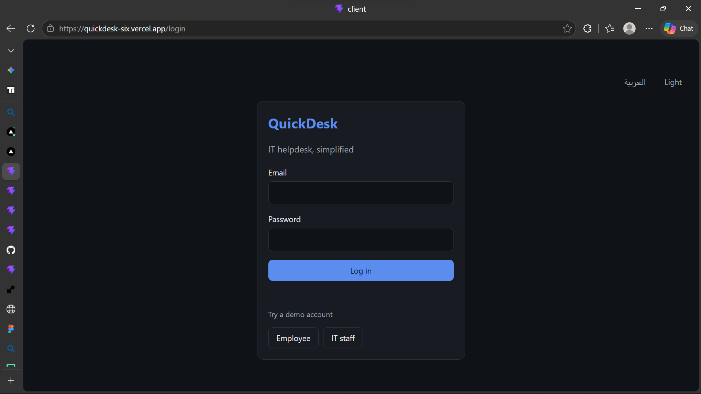

# QuickDesk: IT Helpdesk Ticketing System

A full-stack ticketing app where employees report IT problems and IT staff assign, track, and resolve them. Built as a portfolio project.

**Live demo:** https://quickdesk-six.vercel.app

> Hosted on free tiers. If the app has been idle, the first login can take up to a minute while the API wakes up.

## Demo accounts

| Role     | Email         | Password |
| -------- | ------------- | -------- |
| Employee | sara@test.com | 123456   |
| IT staff | omar@test.com | 123456   |

Use the demo buttons on the login page to fill these in. Please don't enter real data, because the demo database is shared.

## Screenshots




## Features

- JWT authentication with role-based access (employee and IT staff)
- Employees create tickets and see only their own; IT staff see every ticket
- IT staff assign tickets, change status (Open, In progress, Resolved), and comment
- Search and filters by status, priority, category, and assignee (unassigned or mine)
- Arabic and English with a full right-to-left layout
- Dark and light mode, responsive on mobile and desktop

## Tech stack

- **Frontend:** React, React Router, i18next, plain CSS (CSS variables and logical properties)
- **Backend:** Node.js, Express
- **Database:** PostgreSQL (Neon)
- **Auth:** JWT, bcrypt
- **Hosting:** Vercel (client), Render (API)

## How it works

- Roles are enforced **on the server**: middleware checks the token and the role on every protected route, so hiding a button in the UI is never the only protection. For example, an employee calling the status endpoint gets `403 Not allowed`.
- The login page has no public sign-up; the demo accounts are pre-created.
- The client calls `/api/...` on its own domain, and Vercel rewrites those requests to the Render API, so the browser never makes cross-origin calls.

## API overview

| Method | Endpoint                    | Access                              |
| ------ | --------------------------- | ----------------------------------- |
| POST   | `/api/auth/login`           | Public                              |
| GET    | `/api/tickets`              | Logged in (employees see their own) |
| POST   | `/api/tickets`              | Logged in                           |
| GET    | `/api/tickets/:id`          | Owner or IT staff                   |
| PATCH  | `/api/tickets/:id/status`   | IT staff                            |
| PATCH  | `/api/tickets/:id/assign`   | IT staff                            |
| POST   | `/api/tickets/:id/comments` | Owner or IT staff                   |

## Run locally

1. Create a PostgreSQL database and run `server/schema.sql` in it.
2. `cd server`, then `npm install`, and create a `.env` file:
   ```
   DATABASE_URL=your-postgres-connection-string
   JWT_SECRET=a-long-random-string
   PORT=5000
   ```
   Then run `npm run dev`.
3. `cd client`, then `npm install` and `npm run dev`.

## Planned

- Email notifications when a ticket is assigned or resolved
- An AI assistant that suggests a ticket's category and priority
- Restrict account creation to IT staff

## Author

Abdulroqeeb Ibrahim Abiodun, junior developer based in Doha, Qatar.
[GitHub](https://github.com/AbdulroqeebIb)
